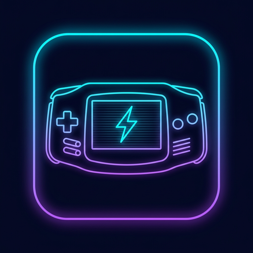

<p align="center">
  
</p>

<h1 align="center">STORM GBCA</h1>

<p align="center">
  <strong>Флагманский кроссплатформенный эмулятор Nintendo Game Boy, Game Boy Color и Game Boy Advance для Android и Windows x64 (mGBA + SameBoy + интерфейс STORM Watermelon / AuroraFluid)</strong><br />
  Версия <code>1.0.0</code> | Платформы: <code>Android (arm64-v8a, armeabi-v7a, x86_64)</code> и <code>Windows x64</code> | Лицензия: <code>MPL-2.0</code>
</p>

<p align="center">
  <a href="https://github.com/ReiKatari/STORM_GBCA">GitHub Repository</a> -
  <a href="https://github.com/ReiKatari/STORM_GBCA/releases/tag/1.0.0">Релиз STORM GBCA 1.0.0</a> -
  <a href="https://stormgamesworld.ru/programs?repo=STORM_GBCA">Страница на STORM GAMES WORLD</a>
</p>

---

## О проекте

**STORM GBCA** - это современный гибридный эмулятор семейства портативных консолей **Nintendo Game Boy (DMG / Pocket / Light / Super Game Boy)**, **Nintendo Game Boy Color (GBC)** и **Nintendo Game Boy Advance (GBA / GBA SP / Game Boy Micro)** для **Android 8.0+ (API 26+)** и **Windows 10/11 (x64)**.

Проект выполнен в фирменном визуальном стиле экосистемы **STORM** (единая дизайн-система **Watermelon** на Android / **AuroraFluid** на Windows, как в **STORM 3DS** и **STORM DS**), полностью очищен от любых лишних элементов Nintendo DS / 3DS и объединяет лучшее из актуальных открытых эмуляторов GB/GBC/GBA вокруг основного ядра **mGBA** с дополнительным высокоточным ядром **SameBoy** для GB/GBC/SGB.

---

## Ключевые особенности и улучшения

### 1. Объединенное нативное ядро: лучшее из лучших эмуляторов GB / GBC / GBA
- **Основное ядро - mGBA (`master`, 2026)**: полная совместимость с **GBA, GBC, GB и Super Game Boy**, встроенный HLE BIOS GBA, поддержка архивов `.zip` и `.7z` (включая полную поддержку кириллических/Unicode путей на Windows), автоопределение типов сохранений (`SRAM`, `Flash 64K/128K`, `EEPROM`), `RTC`, `Solar Sensor`, `Gyro`, `Tilt` и `Rumble`.
- **Дополнительное высокоточное ядро - SameBoy (`v1.0.5`)**: независимый выбор ядра отдельно для **GB** и **GBC** (переключение прямо в настройках или меню паузы), циклическая точность SM83, 7 режимов аппаратной цветокоррекции LCD, 3 режима фильтра верхних частот (`Off` / `Accurate` / `Remove DC`), встроенная поддержка быстрой загрузки без внешних BootROM и переносимость сохранений.
- **Шейдеры и перемотка из SkyEmu (`dev`, 2026)**: единый OpenGL ES 3.0 / CPU постпроцессор `storm_gbca_lcd.glsl` (RGB-субпиксельная сетка LCD, матрица DMG, инерция/гостинг ЖК-матрицы `0..100%`, сглаживание xBRZ-lite, CRT-сканлайны, точное целочисленное масштабирование) и компактный кольцевой буфер перемотки назад с **64-байтным XOR дельта-сжатием**.
- **Улучшения звука и цвета из NanoBoyAdvance (`phoenix`, BSD-2-Clause)**: качественная кубическая/Эрмитова (Hermite) интерполяция звука 48 кГц для GBA DirectSound/MP2K и калиброванные цветовые матрицы экранов AGB-001 / AGS-101.
- **Низкая задержка и плавность из ares (`v148`)**: динамический контроль частоты (**Dynamic Rate Control, DRC**) для идеального звука без щелчков при синхронизации `59.7275 Гц -> 60 Гц` и упреждение кадров (**Run-Ahead `0..2` кадра**) с детерминированным снимком буфера кадра.
- **Палитры, микшер и утилиты из Gambatte, MesenCE, VBA-M и GBE+**:
  - **28 кураторских палитр DMG/GBC/SGB** (классический оливковый DMG, Game Boy Pocket Silver, Game Boy Light Teal, пресеты Super Game Boy 1A-4H, коллекции TWB64 + настраиваемая 4-цветная палитра).
  - **6-канальный аудиомикшер** (`PSG 1 Pulse`, `PSG 2 Pulse`, `PSG 3 Wave`, `PSG 4 Noise`, `GBA DMA A`, `GBA DMA B`, общая громкость) с реальным отключением каналов в обоих ядрах.
  - **Универсальный движок чит-кодов**: GameShark v1/v3, Action Replay v3, CodeBreaker / GameShark SP, Game Genie (GB/GBC) и Raw-коды с нормализацией многострочных списков.
  - **Мягкое патчирование на лету (Soft-Patching)**: встроенная поддержка форматов **IPS, IPS32, UPS и BPS** (автоподхват патча рядом с ROM на Windows и ручной выбор файла патча в меню паузы на Android и Windows).
  - **Аппаратные датчики и аксессуары**: датчик солнечного света Boktai (`0..10 LUX` + горячие клавиши), гироскоп и акселерометр (WarioWare Twisted, Yoshi Topsy-Turvy, Kirby Tilt 'n' Tumble), тактильная отдача `Rumble` (вибромотор Android и моторы XInput на Windows), часы реального времени (`RTC`) и рамки **Super Game Boy (`256x224`)**.

### 2. Независимые 3D-скины консолей отдельно для GB, GBC и GBA
- **Раздельный выбор 3D-скина для каждой системы**: вы можете задать свой уникальный 3D-корпус для **Nintendo GB**, отдельный корпус для **Nintendo GBC** и отдельный корпус для **Nintendo GBA** (плюс независимое ночное затемнение корпуса `30%..100%`, не затемняющее сам игровой экран!). При запуске игры эмулятор автоматически переключается на корпус нужной платформы.
- **26 процедурных 3D-корпусов + режим «Без корпуса (Полный экран)»** (единый каталог на Android и Windows):
  - **Nintendo GB (8 скинов)**: `DMG-01 Классический серый` (с фирменными полосами Dot Matrix), `DMG Play It Loud Черный`, `DMG Прозрачный` (с контурами платы), `Game Boy Pocket Серебро`, `Game Boy Pocket Ледяной`, `Game Boy Light Золото`, `Super Game Boy Рамка`, `STORM Aurora GB`.
  - **Nintendo GBC (8 скинов)**: `Атомный фиолет (Прозрачный)` с внутренним рельефом платы и радужной полосой COLOR, `Ягодный маджента`, `Бирюзовый Teal`, `Киви Лайм`, `Одуванчик Желтый`, `Виноградный фиолет`, `Издание Пикачу`, `STORM Aurora GBC`.
  - **Nintendo GBA (10 скинов)**: `AGB-001 Индиго`, `AGB-001 Ледник (Полупрозрачный)`, `Арктический белый`, `Пряный оранжевый`, `Фуксия Прозрачная`, `GBA SP Кобальтовый синий` (с 3D-шарниром и двойными LED-индикаторами), `GBA SP Черный оникс`, `GBA SP NES Классик`, `Game Boy Micro Famicom 20th`, `STORM Aurora GBA`.

### 3. Независимые оверлеи, раскладки и стили кнопок отдельно для GB, GBC и GBA
- **Раздельные профили оверлея для GB, GBC и GBA**: для каждой консоли отдельно сохраняются раскладка виртуального контроллера (и пользовательские координаты из редактора раскладок), стиль кнопок, экранный шейдер/LCD-оверлей, прозрачность, масштаб, виброотклик и отображение шифтов `L`/`R`.
- **Аутентичная эргономика без лишних кнопок**:
  - Для **GB** и **GBC**: крестовина `D-Pad`, кнопки `A`, `B`, наклонные кнопки `START` и `SELECT` (шифты `L`/`R` скрыты по умолчанию, но могут быть включены при желании).
  - Для **GBA**: крестовина `D-Pad`, кнопки `A`, `B`, верхние триггеры **`L` и `R`**, `START` и `SELECT`.
  - Никаких лишних кнопок `X`/`Y`, `Circle Pad`, `C-Stick` или второго сенсорного экрана.
- **Коллекция фирменных стилей кнопок**: `DMG Маджента`, `GBC Атомный фиолет`, `GBA Индиго`, `GBA Ледник`, `GBA SP Кобальт`, `Micro Famicom`, `STORM Неон`, `Матовый темный`, `Хрустальное стекло`, `Киберпанк`, `Сакура` и др.

### 4. Интерфейс STORM Watermelon / AuroraFluid, библиотека и обновления
- **Полное визуальное единство со STORM 3DS и STORM DS**: 9 тем оформления (`STORM NIGHT`, `STORM DAY`, `MIDNIGHT`, `CYBERPUNK`, `GOTHIC`, `MATRIX`, `SOLAR`, `SAKURA`, `CLASSIC OLED`) + 12/13 цветовых акцентов, 3D-анимация запуска консоли (`Console3DBootScreen` для GB/GBC/GBA), Bento-сетка и таблица коллекционера с 3D-коробками игр.
- **Информативные плашки и метаданные**: цветные плашки платформ (`GB`, `GBC`, `GBA`, `SGB`), плашки регионов (`USA`, `EUR`, `JPN`, `RUS`, `WLD`), аппаратные индикаторы (`RTC`, `SOLAR`, `RUMBLE`, `GYRO`), автоматическая загрузка обложек из **Libretro Thumbnails** (`Nintendo - Game Boy`, `Nintendo - Game Boy Color`, `Nintendo - Game Boy Advance`) и полноэкранный просмотр обложки.
- **RetroAchievements (`rcheevos v12.5.0`)**: вычисление официальных хешей GB/GBC/GBA, доступ к памяти (`WRAM`, `IWRAM`, `EWRAM`, `HRAM`, `SRAM`), список достижений и Hardcore-режим.
- **Двойное зеркало автообновлений (`StormUpdateMirrorClient` / `AuroraDualMirrorUpdater`)**: проверка и загрузка свежих версий напрямую с **GitHub Releases** и **STORM GAMES WORLD** (`stormgamesworld.ru/programs?repo=STORM_GBCA`) с отображением скорости загрузки и списка изменений.

---

## Релиз 1.0.0

| Файл релиза | Назначение | Ключевые возможности |
| --- | --- | --- |
| `STORM_GBCA_1.0.0.apk` | Подписанная универсальная сборка для Android 8.0+ (`arm64-v8a`, `armeabi-v7a`, `x86_64`) | Нативное ядро `libstorm_gbca_core.so` (16 КБ выравнивание страниц, `mGBA` + `SameBoy` + `Oboe` + `GLES 3.0`), интерфейс STORM Watermelon, 26 3D-скинов и независимые оверлеи для GB/GBC/GBA, редактор раскладок, мягкие патчи IPS/UPS/BPS, скриншоты, геймпады (включая аналоговые триггеры LT/RT) и RetroAchievements |
| `STORM_GBCA_1.0.0_Windows.zip` | Портативная сборка для Windows 10/11 (x64) | Автономный `STORM GBCA.exe` + нативное ядро `storm_gbca_core.dll`, интерфейс STORM AuroraFluid, 26 процедурных 3D-скинов на SkiaSharp и интерактивные оверлеи для GB/GBC/GBA, звук WinMM 48 кГц с DRC, XInput с вибрацией, Drag-and-Drop ROM и патчей, 10 слотов сохранений и двойное зеркало обновлений |
| `STORM_GBCA_1.0.0_Setup.exe` | Установщик для Windows 10/11 (x64) | Единый графический установщик STORM AuroraFluid с распаковкой в `%LOCALAPPDATA%\Programs\STORM GBCA`, созданием ярлыков на рабочем столе и в меню Пуск, регистрацией в «Установке и удалении программ» Windows и скриптом чистого удаления |

---

## Инструкция по использованию и горячие клавиши

### Быстрый старт (Android и Windows)
1. Запустите **STORM GBCA** и нажмите **«Добавить папку ROM»** (на Windows также поддерживается перетаскивание файлов `.gb`, `.gbc`, `.gba`, `.sgb`, `.zip`, `.7z` прямо в окно программы).
2. Фильтруйте библиотеку по плашкам **Все / GB / GBC / GBA / Избранное**.
3. В разделе **«Корпуса и оверлеи»** (или прямо во время игры через меню паузы) выберите вкладку **`[GB]`**, **`[GBC]`** или **`[GBA]`**, чтобы независимо настроить свой **3D-скин**, **стиль кнопок**, **раскладку оверлея** и **LCD-шейдер** для каждой консоли.
4. При желании выберите для **GB/GBC** альтернативное ядро **SameBoy** в разделе **«Настройки -> Ядро эмуляции»** (`mGBA` используется по умолчанию для всех платформ).
5. Для игр с переводом или ромхаками перетащите `.ips` / `.ups` / `.bps` в окно игры на Windows или нажмите **«Мягкий патч»** в меню паузы на Android.

### Горячие клавиши (Windows)
- **Управление**: Стрелки / `WASD` (D-Pad), `Z` / `J` (A), `X` / `K` (B), `A` / `Q` (L), `S` / `E` (R), `Enter` (Start), `Right Shift` / `Backspace` (Select) + полная поддержка геймпадов **XInput** с виброотдачей.
- **`Esc`** - Открыть / закрыть меню паузы
- **`F1` / `F2`** - Быстрое сохранение / Быстрая загрузка (слот 0)
- **`Space` / `Tab`** - Ускорение эмуляции (Fast-Forward)
- **`R` / `Backspace`** - Перемотка времени назад (Rewind)
- **`F5` / `F6`** - Уменьшить / увеличить яркость солнечного датчика Boktai (`0..10 LUX`)
- **`F11`** - Полноэкранный режим
- **`F12`** - Сохранить скриншот в PNG (`%APPDATA%\STORM_GBCA\screenshots`)

---

## Сборка из исходного кода

### Требования (Android)
- **JDK**: 21
- **Android SDK**: Platform 36 (`compileSdk = 36`, `minSdk = 26`)
- **Android NDK**: `28.0.13004108`
- **CMake**: `3.22.1+` + **Ninja**

### Требования (Windows x64)
- **Visual Studio 2022 / Insiders (MSVC)** + **CMake** + **Ninja** + **Windows SDK 10.0** (для нативной библиотеки `storm_gbca_core.dll`)
- **.NET 10 SDK** (`10.0+`) (для интерфейса Avalonia UI и установщика)

### Команды сборки
```bash
git clone https://github.com/ReiKatari/STORM_GBCA.git
cd STORM_GBCA

# 1. Нативное ядро (Windows x64, низконагруженная сборка)
cmake -S core -B core/build_win -G Ninja -DCMAKE_BUILD_TYPE=Release
cmake --build core/build_win --parallel 4
./core/build_win/core_smoke_test.exe

# 2. Клиент Windows x64 (.NET 10 + Avalonia)
dotnet publish windows/src/StormGbca.Desktop/StormGbca.Desktop.csproj -c Release -r win-x64 --self-contained true -m:4

# 3. Релизная сборка Android APK (низконагруженная сборка)
./gradlew :app:assembleRelease --max-workers=3 -Dorg.gradle.priority=low
```
Готовые артефакты релиза сохраняются в папку `releases/`:
- `releases/STORM_GBCA_1.0.0.apk`
- `releases/STORM_GBCA_1.0.0_Windows.zip`
- `releases/STORM_GBCA_1.0.0_Setup.exe`

---

## Благодарности и открытые проекты (Credits)

Проект **STORM GBCA** создан благодаря выдающейся работе авторов и сообществ следующих открытых проектов:

- **[mGBA](https://github.com/mgba-emu/mgba)** (**endrift** и участники проекта) - основное высокоскоростное и точное ядро эмуляции Nintendo Game Boy, Game Boy Color, Super Game Boy и Game Boy Advance (MPL-2.0).
- **[SameBoy](https://github.com/LIJI32/SameBoy)** (**Lior Halphon / LIJI32**) - дополнительное высокоточное ядро для GB/GBC/SGB, эталонные 7 режимов цветокоррекции LCD и 3-режимный фильтр верхних частот аудио (MIT).
- **[SkyEmu](https://github.com/skylersaleh/SkyEmu)** (**Skyler Saleh**) - архитектура единого LCD/субпиксельного шейдера с гостингом и концепция 64-байтного XOR дельта-сжатия буфера перемотки назад (MIT).
- **[NanoBoyAdvance (`phoenix`)](https://codeberg.org/nba-emu/NanoBoyAdvance)** (**fleroviux**) - референс высококачественной интерполяции GBA-аудио (MP2K / DirectSound) и цветовых матриц LCD AGB-001 / AGS-101 (BSD-2-Clause).
- **[ares](https://github.com/ares-emulator/ares)** (**Near** и команда ares) - идеи динамического контроля частоты аудио (Dynamic Rate Control) и упреждения кадров Run-Ahead (ISC).
- **[Gambatte-libretro](https://github.com/libretro/gambatte-libretro)** (**sinamas** и команда libretro) - вдохновение и коллекция классических цветовых палитр DMG / GBC / SGB / TWB64.
- **[VisualBoyAdvance-M](https://github.com/visualboyadvance-m/visualboyadvance-m)**, **[MesenCE](https://github.com/nesdev-org/MesenCE)** (**Sour**) и **[GBE+](https://github.com/shonumi/gbe-plus)** (**Shonumi**) - вдохновение для универсального парсера чит-кодов, поканального 6-канального аудиомикшера и удобства работы с аппаратными датчиками (Solar / Tilt / Gyro / Rumble).
- **[RetroAchievements / rcheevos](https://github.com/RetroAchievements/rcheevos)** (**Jamiras** и сообщество RetroAchievements) - официальная C-библиотека хеширования ROM и достижений (MIT).
- **[Google Oboe](https://github.com/google/oboe)** - библиотека низколатентного вывода аудио AAudio / OpenSL ES для Android (Apache-2.0).
- **[WatermelonDS](https://github.com/SapphireRhodonite/WatermelonDS)** (**SapphireRhodonite**), **[STORM 3DS](https://github.com/ReiKatari/STORM_3DS)** и **[STORM DS](https://github.com/ReiKatari/STORM_DS)** (**STORM TEAM**) - фирменная визуальная дизайн-система STORM Watermelon / AuroraFluid, концепция процедурных 3D-скинов и двойное зеркало обновлений.
- **[Avalonia UI](https://avaloniaui.net/)**, **[SkiaSharp](https://github.com/mono/SkiaSharp)**, **Jetpack Compose**, **Coil** и **[Libretro Thumbnails](https://github.com/libretro-thumbnails)** - UI-фреймворки, процедурный 2D/3D-рендеринг и база обложек игр.

---

## Лицензия

Исходный код **STORM GBCA** распространяется под лицензией **Mozilla Public License 2.0 (MPL-2.0)** ([LICENSE](LICENSE)) с полным соблюдением лицензий всех интегрированных библиотек с открытым исходным кодом (mGBA MPL-2.0, SameBoy MIT, SkyEmu MIT, NanoBoyAdvance phoenix BSD-2-Clause, ares ISC, rcheevos MIT, Google Oboe Apache-2.0).
